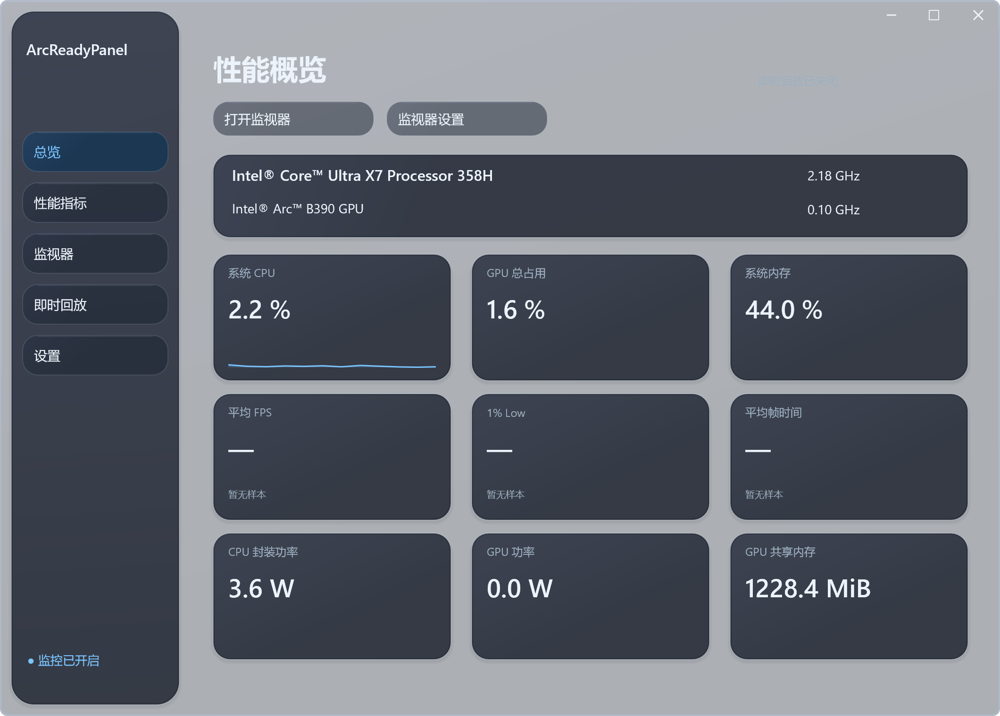
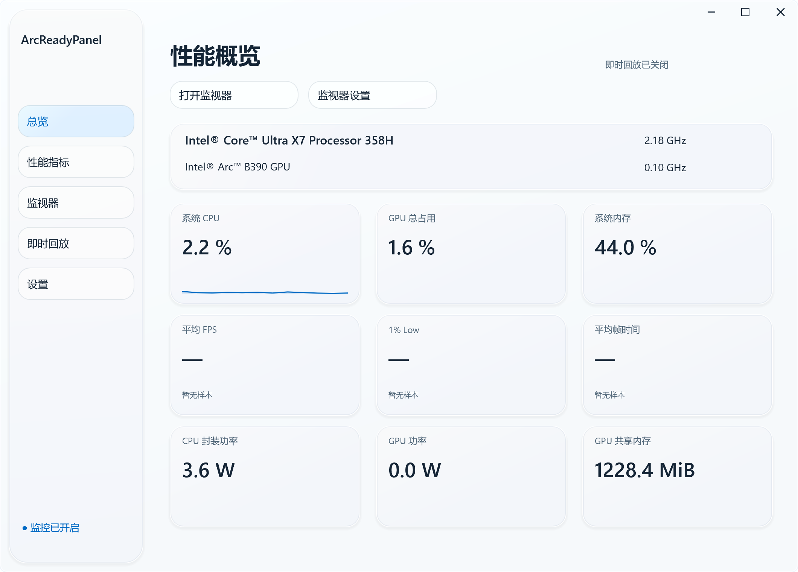

# ArcReadyPanel

Windows 11 原生性能监控与 Intel GPU 桌面即时回放工具。采用 C++23 和 Windows 原生图形组件，支持透明监视器、独立主题、历史曲线以及 AV1 硬件回放。

## 界面预览

### 深色模式



### 浅色模式



主界面参考图由当前版本内置预览功能生成。

## 功能

### 性能监控

- 系统 CPU、进程 CPU、内存用量，以及 Intel GPU 渲染、计算、视频编解码、频率、功率和显存指标。
- 平均 FPS、1% Low、平均帧时间和 P99 帧时间，支持自动跟随焦点或手动选择目标窗口。
- 指标独立设置采样周期、显示状态、历史长度、名称、字体、字号和颜色。

### 桌面监视器

- 透明背景、鼠标穿透、置顶显示与位置调整。
- 独立深浅主题、跟随系统、界面缩放、列数和行间距调整。
- 单项完整曲线，曲线宽度可调。
- 关闭监视器即停止性能采样。

### 即时回放

- 捕获当前显示器的完整桌面，使用 Intel oneVPL AV1 硬件编码。
- 15–120 FPS、1–150 Mbps、15–1800 秒回放时长，支持原生及自定义分辨率。
- RAM 或磁盘环形缓存，可自定义缓存容量、缓存目录与保存目录。
- WASAPI 系统声音跟随默认播放设备，切换耳机或扬声器时自动连接；AAC 双声道音频。
- 快捷键开关回放与保存 MP4，保存过程在后台执行。
- 开关、保存与恢复通知，支持通知位置预设。
- 合盖和休眠时暂停，恢复后按之前状态重新开启。

### 外观与启动

- 深色、浅色与系统主题，玻璃质感界面和过渡动画。
- 托盘运行、登录启动、静默启动和管理员运行选项。
- 配置保存在程序旁的 ArcReadyPanel.settings。

## 下载与使用

在本仓库 **Releases** 下载便携版 ZIP，解压后运行 **ArcReadyPanel.exe**。

当前发布包预置作者使用的配置，包括外观、监视器布局、快捷键、回放和启动选项。首次运行可在设置页调整。若希望使用程序默认值，退出后删除 ArcReadyPanel.settings，再启动软件。

| 操作 | 程序默认快捷键 |
| --- | --- |
| 开关监视器 | Ctrl + Alt + O |
| 开关即时回放 | Alt + F9 |
| 保存即时回放 | Alt + F10 |
| 显示或隐藏控制中心 | Ctrl + Alt + G |

预置配置使用作者的自定义绑定，实际快捷键以设置页显示为准。

默认保存位置为 Windows“视频”目录下的 ArcReadyPanel；默认磁盘缓存位置为 %LOCALAPPDATA%/ArcReadyPanel/ReplayCache。两者均可在软件内修改。

## 系统与硬件

- Windows 11 x64。
- Intel GPU 及适用的 Intel 图形驱动。
- AV1 回放使用支持硬件 AV1 编码的 Intel Arc 或 Core Ultra 集成显卡，录制显示器连接到所选 Intel GPU。
- 当前回放格式：SDR 8-bit AV1 视频、AAC 系统声音、MP4 容器。
- 已实测：Intel Core Ultra X7 Processor 358H + Intel Arc B390 GPU。

其他平台及指标支持情况见 [兼容性说明](docs/compatibility.md)。

## 低开销设计

- 模块按需初始化，关闭后释放捕获、编码和采样资源。
- 桌面纹理在 GPU 上完成缩放与 NV12 转换，使用 Intel 专用媒体硬件编码。
- 支持直接纹理输入和 GPU 复制兼容路径。
- 缓存压缩后的数据，保存时直接封装 MP4。
- 采样与捕获使用事件等待，界面按变化重绘，动画结束后停止刷新。

## 从源码编译

安装支持 C++23 的 MSVC、Windows SDK、Visual Studio“使用 C++ 的桌面开发”工作负载，以及 CMake 3.25 或更新版本。

```powershell
cmake -S . -B build -A x64
cmake --build build --config Release
```

程序输出：build/Release/ArcReadyPanel.exe。

```powershell
ctest --test-dir build -C Release --output-on-failure
```

图形、帧事件及回放集成测试使用本机 Intel GPU 和交互式 Windows 会话。

## 项目说明

ArcReadyPanel 为独立开发项目。第三方组件和资源说明见 [THIRD_PARTY_NOTICES.md](THIRD_PARTY_NOTICES.md)。
